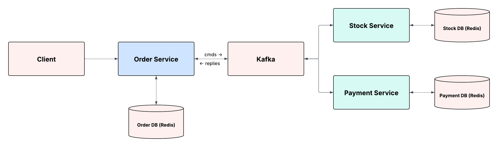
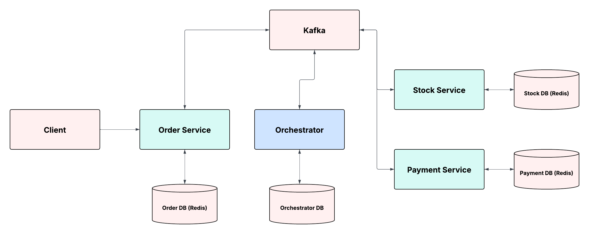

# Distributed Data Systems Project

We implement a distributed webshop using microservices for order, payment, and stock. Each service has its own Redis database and the services communicate internally through Kafka.

The four implementations live in separate folders in this repository and before were developed on a 4 separate branches:

| Implementation | Original branch | Protocol | Architecture |
|---|---|---|---|
| [`2pc/`](2pc/README.md) | `2pc_normal_scalability` | 2PC | Order service coordinates directly |
| [`saga/`](saga/README.md) | `saga_high_load_fix` | Saga | Order service coordinates directly |
| [`2pc_orchestrator/`](2pc_orchestrator/README.md) | `2pc_orchestrator_scalability` | 2PC | Dedicated orchestrator service |
| [`saga_orchestrator/`](saga_orchestrator/README.md) | `saga_orchestrator_sentinel` | Saga | Dedicated orchestrator service |

Each folder contains its own service code, Docker Compose configurations, and
tests. Choose a folder to run an implementation; no branch switch is required.

## 2PC

Checkout runs as a two-phase commit. In the prepare phase, stock locks the required units and payment locks the required credit. Only once both confirm does the coordinator send commits. If any participant fails to prepare, both are aborted. The commit phase retries indefinitely, once entered it is irrevocable. State is checkpointed to Redis at each step so a crash mid-protocol can be recovered on restart.

## Saga

Checkout is a sequence of local transactions with compensating actions on failure. Stock is reserved first, then payment is charged. If payment fails, reserved stock is released. If a crash occurs mid-saga, recovery forward-completes or compensates depending on how far the saga had progressed.



*Without orchestrator*

## Orchestrator

In the direct variants the order service runs the full protocol itself. In the orchestrator variants a dedicated service handles coordination.



*With orchestrator*

## Project structure

Each implementation follows this layout:

```text
<implementation>/
├── README.md
├── order/
├── payment/
├── stock/
├── env/
├── compose/
│   ├── docker-compose.yml
│   ├── docker-compose-medium.yml
│   ├── docker-compose-large.yml
│   ├── nginx/
│   └── kafka/
└── tests/
    ├── test_microservices.py
    ├── fault_tolerance_test.py
    ├── kill_test.py
    ├── utils.py
    └── smoke/
```

The orchestrator variants also contain `orchestrator/`.

Service Dockerfiles and dependencies live with each service. Compose gateway
configurations and Kafka topic initialization scripts live in `compose/nginx/`
and `compose/kafka/`, respectively. Deployment uses Docker Compose.

## Deployment

**Requirements:** Docker and Docker Compose. Python 3.10 or newer is needed to
run the local tests, the services run inside Docker.

From the repository root, choose an implementation folder. This example runs
Saga; use `2pc`, `2pc_orchestrator`, or `saga_orchestrator` for the other variants:

```bash
cd saga
docker compose -p order-processing -f compose/docker-compose.yml up -d --build
```

The gateway is available at `http://localhost:8000`.

Run the following commands from the selected implementation folder:

```bash
# Small config
docker compose -p order-processing -f compose/docker-compose.yml up -d --build

# Medium config
docker compose -p order-processing -f compose/docker-compose-medium.yml up -d --build

# Large config
docker compose -p order-processing -f compose/docker-compose-large.yml up -d --build

# Stop the default config
docker compose -p order-processing -f compose/docker-compose.yml down
```

Each deployment size is a standalone configuration. The configs vary in service replicas, worker counts, CPU limits, Redis memory, and Kafka partitions. The three configurations let us test how throughput, latency, and reliability change as service concurrency and resource capacity increase from small to medium to large deployments. Choose one at a time and use the same `-f` option when starting, stopping, or inspecting it.

Keep `-p order-processing` in every Compose command: the tests and watchdogs
expect that container name prefix. Run one implementation at a time and stop it
using its own Compose file before switching implementations. The common project
name also shares named Redis volumes across implementations. Add `-v` to `down`
only when you want to delete those volumes.

## Fault Tolerance

Each deployment includes a watchdog to restart service and database containers
during fault-injection experiments.

The automated fault test kills containers during checkout traffic and then
checks stock and credit consistency. The manual kill test supplies checkout
traffic while you choose which containers to kill.

## Scalability

Each implementation provides three deployment configurations in `compose/`:

| Configuration | File |
|---|---|
| Default | `docker-compose.yml` |
| Medium | `docker-compose-medium.yml` |
| Large | `docker-compose-large.yml` |

Each configuration selects its matching gateway settings and Kafka topic script.

## Testing

Run tests from the chosen implementation folder against its running deployment.
Install the test client dependencies locally:

```bash
python3 -m pip install requests aiohttp
```

| Test | Availability | Purpose |
|---|---|---|
| `tests/test_microservices.py` | API integration checks for order, stock, and payment |
| `tests/smoke/` | Checkout idempotency, insufficient stock, and insufficient credit |
| `tests/fault_tolerance_test.py` | Automated container kills under checkout load and final consistency checks |
| `tests/kill_test.py` | Checkout load for manual container kills and final consistency checks |

### Integration and smoke tests

```bash
python3 tests/test_microservices.py
bash tests/smoke/insufficient_stock.sh
bash tests/smoke/insufficient_credit.sh
```


### Fault-tolerance and manual kill tests

Run one test at a time against the deployment:

```bash
# Automatically kill containers during checkout load
python3 tests/fault_tolerance_test.py

# Generate checkout load while you manually kill containers
python3 tests/kill_test.py
```


## Benchmark (wdm-project-benchmark)

Clone the benchmark repo:
```bash
git clone https://github.com/delftdata/wdm-project-benchmark
cd wdm-project-benchmark
pip install -r requirements.txt
```

Edit `urls.json` to point at your gateway (default is `localhost:8000`).

### Consistency test

```bash
cd consistency-test
python run_consistency_test.py
cd ..
```

### Stress test


```bash
cd stress-test
python init_orders.py
locust -f locustfile.py --host="http://localhost:8000"
```

Open `http://localhost:8089` for the Locust UI.
